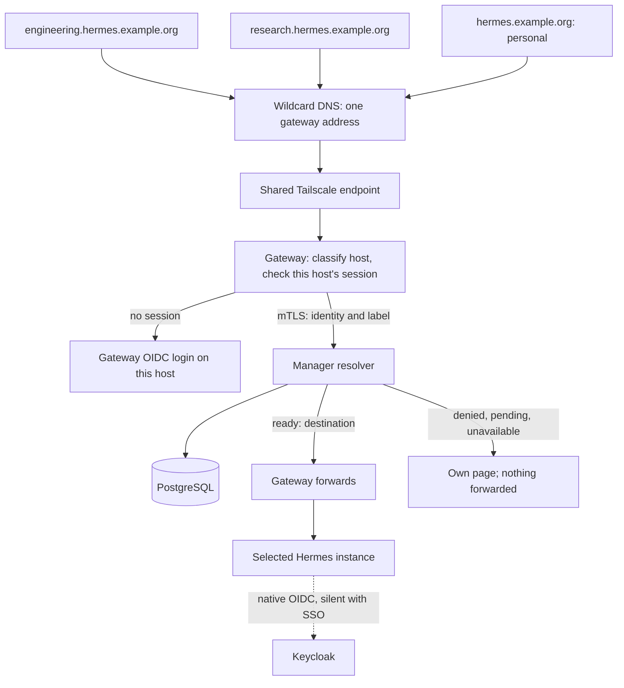

# Planned: Personal, team and generic Hermes agents

**Status: Phase 0 is verified; shared-agent implementation is in progress.** This document
specifies the extension from personal instances to shared Hermes agents with
explicit access grants and their own hostnames. It does not change the built
behaviour defined in
[SPEC.md](SPEC.md), [ARCH.md](ARCH.md) or the
[implementation status](personal-hermes/implementation.md). Until a phase below
lands, this document is the specification for that phase; when it lands, its text
moves into those documents.

Work through the [implementation phases](#planned-implementation-phases) in
order. Each ends in a gate of named checks, and the
[acceptance cases](#planned-acceptance-cases) define when the feature is correct.
The design decisions below are settled and were checked against the code and the
pinned runtime. Change one only by changing this document first. What remains
undecided is listed under [Open decisions](#open-decisions), with what must happen
first.

## Planned scope

An administrator can create a shared Hermes agent, configure its template and
enforced settings, assign its storage and terminal backends, choose a hostname, and
grant access to users or groups. Every dashboard workflow is also
available through the administration API.

The platform's part is getting the right people connected to the right instance.
How several users work inside one instance is Hermes's part; see
[Responsibility boundary](#planned-responsibility-boundary).

- **Personal agents:** one owner's private instance, selected by verified identity
  at the installation's common personal endpoint. Routing, storage and lifecycle are
  unchanged. The owner pin is removed ([D2](#planned-design-decisions)).
- **Team and generic agents:** one shared-agent model. A persistent shared
  instance with an administrator-chosen name and audience, such as engineering or
  support. Names and grants distinguish their purpose; there is no separate
  lifecycle. Generic does not mean anonymous or available to everyone.

A user can access several agents. Access to a shared agent neither requires a
personal assignment nor creates a personal instance.

Outside the initial feature:

- external backend URLs and user-supplied proxy destinations;
- anonymous access, and a grant to all authenticated users;
- a viewer role or any other permission enforced by HTTP method or proxy path;
- delegating administration of an agent to its members;
- a page listing a user's agents: administrators share the URLs;
- Keycloak groups as a membership source;
- converting a personal agent to a shared one, or the reverse.

## Verified constraints

These facts were established against the source tree, the pinned Hermes image
(`nousresearch/hermes-agent@sha256:d4da4a40…`, as patched by
`runtimes/hermes/Dockerfile`) and the pinned Keycloak 26.8.0 image. The design
depends on them. Facts marked as experiments come from disposable, networkless
or loopback-only probes that are not checked in. Collected Phase 0 cases cover
native login, refresh, logout, home binding and callbacks on the project image;
[SH-N01 to SH-N05](#native-runtime) also include the runtime work in Phase 4.

| ID | Fact | How it was established | Consequence |
| --- | --- | --- | --- |
| E1 | Keycloak refuses a redirect URI with a wildcard in its host: a client registered with `https://*.hermes.example.org/_platform/oidc/callback` answers `400 Invalid parameter: redirect_uri` for `https://engineering.hermes.example.org/_platform/oidc/callback`. | Experiment on the pinned image | Each hostname's gateway and native callbacks are registered in Keycloak individually. See [D1 and D2](#planned-design-decisions) |
| E2 | The gateway has one OIDC callback, and `BrowserAuth::new` refuses any other. Its session cookies are `__Host-` and so per host. | `hermes-gateway/src/lib.rs`, `hermes-identity/src/browser.rs` | The gateway must log in per host. See [Sign-in on each host](#sign-in-on-each-host) |
| E3 | Native OIDC builds its redirect URI from `HERMES_DASHBOARD_PUBLIC_URL`. Without it, the URI comes from the request, whose scheme is `https` only if `dashboard.trusted_proxies` trusts the gateway's address; no such setting is rendered today, and a test with an untrusted caller produced `http://engineering.hermes.example.org/auth/callback`. | `hermes_cli/dashboard_auth/routes.py`, `hermes_cli/web_server_lifecycle.py`, `hermes-render/src/instance.rs`, experiment | Each shared instance gets its own hostname as its public URL, as a personal one does, so a rename restarts its Pod |
| E4 | The owner pin is our patch, not an upstream feature. `patch-dashboard-owner.py` also adds the `terminal.runtime_id` setting, and the owner context also binds the home in `personal-init.py` and `personal-run.py`. | Source | Removing the pin must keep the setting and the home binding. See [Removing the owner pin](#removing-the-owner-pin) |
| E5 | Native login cannot be disabled. On a non-loopback bind, the dashboard refuses to start without a registered provider, and `--insecure` is ignored. Binding `0.0.0.0` accepts any `Host`. | `hermes_cli/web_server.py`, experiment | Shared instances keep a login provider. The router's forwarded hostname is accepted |
| E6 | The pinned image does not separate users: with two identities, one read the other's sessions, a stored `.env` value and test copies of the instance's credential files, and deleted the other's cron job. | Experiment | Hermes's part; see [Responsibility boundary](#planned-responsibility-boundary). Recorded for whoever chooses the image, and not a platform obligation |
| E7 | A member can register another auth provider by writing `dashboard.basic_auth` to the home's `config.yaml`. A blank `dashboard.basic_auth` in the managed configuration prevents this. | Experiment | [Managed configuration](#managed-configuration) |
| E8 | The auth-gate probe requires exactly one provider named `self-hosted` and a redirect to it. | `hermes-native/src/probe.rs` | Stays valid for both kinds, so it needs no variant |
| E9 | The gateway ignores the request's `Host`, serves HTTP/2 and reads its certificate once at startup. | `hermes-proxy/src/gateway.rs`, `hermes-http/src/server.rs`, `hermes-gateway/src/lib.rs` | [Host classification](#host-classification) and [certificate reload](#planned-deployment-configuration) are new work |
| E10 | Any cookie whose name merely contains `hermes-platform` makes the gateway refuse the request as ambiguous. Script on a sibling host can set `hermes-platform=x; Domain=hermes.example.org`, which would lock the user out of every host beneath that domain. | `hermes-proxy/src/hygiene.rs` | [Cookie rules](#cookies-and-request-hygiene) |
| E11 | Open connections end when the resolver's answer differs from their `Route`. The route contains the assignment's version and desired generation, not any grant data. | `hermes-proxy/src/supervise.rs`, `hermes-core/src/domain/routing.rs` | Grant changes need no revision counter. See [D5](#planned-design-decisions) |
| E12 | Tailscale's documented layer 3 ingress is a `LoadBalancer` Service with `loadBalancerClass: tailscale`, optionally with `tailscale.com/proxy-group`; the operator creates one Tailscale Service per HA-exposed Service. Its advertisement needs tailnet `autoApprovers`, and grants decide who reaches it. | Provider documentation | The shared exposure design holds. The chart's gateway Service supports only `type` and `port` today |
| E13 | Native cookie names depend on the scheme Hermes sees. Without a trusted proxy it sees `http`, and so uses bare names such as `hermes_session_at`. A sibling host's script can set bare names with a parent `Domain`. | `hermes_cli/dashboard_auth/cookies.py` | The gateway must forward these names. See the [accepted consequences](#accepted-consequences) |
| E14 | With no owner pin, one instance serves several users: two Keycloak users logged in natively, each got their own `user_id`, and both had a ticketed WebSocket open at once. | Experiment: unmodified upstream image and real Keycloak | [D2](#planned-design-decisions) works |
| E15 | One browser can use several agents. Only the first login, gateway or native, showed a form; the rest, on two hostnames and both clients, were silent. Refreshing tokens alternately on each hostname kept all of them working, with "Revoke Refresh Token" off and on. | Same experiment | No Keycloak setting is required, and logging in per host works |
| E16 | Logout reaches across hosts. Revoking a client's refresh token removes that client from the person's Keycloak session, so that person's refresh for the same client on another hostname fails. Another person is unaffected. Silent sign-in continues while another client remains active; revoking the last client makes the next sign-in show the login form. | Collected Phase 0 tests on the project image, with native logout and real Keycloak code exchanges for both clients | [Logout](#logout) |

The experiments for E14 and E15 called token endpoints and instances directly,
with short token lifetimes over loopback HTTP. The collected Phase 0 tests use
the project image, real Keycloak and forwarded hostnames over TLS. They use
scripted HTTP and WebSocket clients; SH-E05 covers the full gateway and browser
path, including chat.

## Planned design decisions

| ID | Decision | Reason | Rejected |
| --- | --- | --- | --- |
| D1 | Every hostname logs in to the gateway directly. The gateway has one callback per host, and a session belongs to one host. | Native login already needs a Keycloak step per agent, so a second callback in that step costs little. The gateway keeps its existing login code, and gains no handoff, parent sessions or extra tables | A handoff through one sign-in origin (one callback fewer per agent, for much more new code in the gateway). Path-based agents on one host (agents would share an origin, so one agent's page could act on another) |
| D2 | The router is the only access control. Every agent uses Hermes's unmodified native OIDC login, and the owner pin is removed from the image, for personal agents too. | The router is trusted and crucial in any case. Hermes stays vanilla in its login path, and every agent logs in the same way. Keycloak single sign-on avoids a second login form | A signed-token plugin (a key, rotation and a plugin to maintain). Disabling login (E5). Keeping the pin on personal agents as a second check |
| D3 | One hostname per shared agent at a time. It can be renamed, and a freed name can be used by another agent. A rename restarts the agent's Pod, and its new callback must be registered in Keycloak first. | The router checks grants on every request, so a reused name admits nobody without a grant, and open connections end when the route changes. Browser data kept for the old agent matters only to someone granted both agents, and is accepted | Permanent names (a mistyped label would force a new agent) and retired-name records |
| D4 | A shared agent is an assignment of kind `shared`, with no identity. | Volumes, backends, secrets, rollouts, instances, materials and the planner all hang off the assignment already. A parallel `Agent` aggregate would duplicate them | A new `Agent` aggregate replacing assignments |
| D5 | No authorization revision. Grants, memberships and endpoint state are read on every resolve; grant, group and enable or disable commands bump neither the assignment's version nor its generation. | The existing recheck loop already meets the 5 s and 10 s bounds on every replica, and removing one member changes the answer only for that member | Revision counters and invalidation |
| D6 | Removing a member ends that member's connections and new access, and does nothing inside the instance. Suspending the agent stops the whole instance. | Work inside an instance is Hermes's, and the platform has no view of who started what | Platform-level cancellation of one member's work |
| D7 | Disabled and ungranted hostnames answer identically after sign-in. Hostnames are not secret: an unregistered name fails at Keycloak, because it has no callback. | Knowing a name grants nothing, because the router still decides | Hiding which names exist, which per-host login makes impossible without a check before sign-in |

### Accepted consequences

- **One line of defence.** A routing bug or a compromised gateway can put any valid realm
  login on any instance, including a personal one holding private data. Previously the
  owner pin refused that login. NetworkPolicy still admits only the gateway and controller
  to native ports, and the home's owner binding still stops an instance starting on another
  owner's data.
- **Hermes's identity is not a platform guarantee.** Each member's native tokens pass
  through the shared instance, where agent code runs. A token for one instance is accepted
  by any other, because they share one Keycloak client, and a sibling's script can set bare
  native cookies (E13). This can confuse who Hermes thinks a user is. It cannot get anyone
  past the router, which decides from its own session.

## Planned responsibility boundary

| Platform | Hermes |
| --- | --- |
| Who may connect: grants, groups and endpoints | Everything about several users inside one instance: separating or sharing conversations, memory, files, profiles and settings |
| Routing each request to the right instance, and refusing everyone else | Concurrent use, including two users in one session |
| Configuring native OIDC, so that Hermes learns who each user is | Per-user permissions, and what each user may see of the instance's secrets and credentials |
| Closing a user's connections when access ends | What happens to a removed user's runs, cron jobs, pairings and other work |
| Instance lifecycle, storage, credentials, terminal backends and enforced settings | Attributing and cancelling runs per user |

The platform neither works around nor tests Hermes's side, and this feature does not wait
for it. The dashboard and guides must not promise privacy between members: which
guarantees a shared agent has depends on its template's Hermes image (E6).

### Capacity

One Hermes Pod serves every member, with the template's CPU and memory. A template
or admin setting change restarts it with the existing Recreate rollout and
interrupts everyone. `maxEnvironments` limits the agent as a whole, so a busy team
sees `503` sooner than one person does. `per_session` mode gives each session its
own worker; the profile modes share a worker among everyone using that profile.

## Planned domain model

PostgreSQL remains authoritative. Identities remain exact verified
`(issuer, subject)` values; email, display names and browser-supplied headers are
never authorization keys. All states are typed enums, all writes go through the
command envelope, and no `serde_json::Value` crosses a port.

| Record | Rules |
| --- | --- |
| Assignment (extended) | `kind ∈ {Personal, Shared}`, immutable. Personal has its exact identity. Shared has a `name` (unique among shared assignments, `validate_name`) and a `display_name`, and no identity. Access states, template, volumes, backends, overrides, secrets, version and generations behave as today. One assignment converges to one instance |
| Endpoint | Exactly one per shared assignment, created in the same transaction. A `label`, `enabled` and `version`. The label is unique among current endpoints and can change (D3); the assignment cannot, and the row is not deleted. A personal assignment has none |
| Agent grant | `(assignment, principal)`, where the principal is exactly one of an identity or an access group. Shared assignments only. The grant set has one `grants_version` |
| Access group | `id`, unique `name`, `display_name`, `version`. A group with grants cannot be deleted (`409 group_in_use`). Membership alone never provisions anything |
| Group membership | `(group, identity)` |

Migration `0012` (planned):

- `manager.assignments` gains `kind` (`DEFAULT 'personal'`), `name`, `display_name`
  and `grants_version`. `identity_id` becomes nullable, with
  `CHECK ((kind = 'personal' AND identity_id IS NOT NULL AND name IS NULL) OR
  (kind = 'shared' AND identity_id IS NULL AND name IS NOT NULL))`. The existing
  `UNIQUE (identity_id)` keeps one personal agent per identity. Existing rows,
  instance IDs and material are untouched.
- New tables `manager.endpoints`, `manager.agent_grants`, `manager.access_groups`
  and `manager.access_group_members`.
- Guard triggers, each naming the rule it mirrors: `kind` is immutable; an endpoint
  row cannot be deleted and its assignment cannot change; grants and
  endpoints reference only shared assignments.
- Personal route resolution keeps its query, which finds only personal assignments
  because shared ones have no identity. The reverse is a trap: every other query that
  inner-joins `manager.identities` through an assignment (in `hermes-store`'s
  `queries.rs`, `controller.rs` and `access.rs`) would silently drop shared agents, and
  must be reviewed. SH-D08 and SH-E01 prove none does.

In `hermes-core`, `DesiredInstance.identity` becomes a typed
`InstanceBinding::{Personal(Identity), Shared { agent_id }}`, so that rendering
cannot silently pick an owner for a shared instance.

### Access semantics

The permission is `use`, and it is implicit in a grant. Platform administrators need
`Administer` to change any of this, and hold no access to a shared agent without a
grant of their own.

An identity may use a shared agent when all of these hold in one database snapshot
(one SQL statement):

1. the endpoint exists and is enabled;
2. the assignment's access is `enabled`;
3. a grant names the identity directly, or names a group it currently belongs to.

Otherwise the answer is `denied`, with nothing further revealed. Readiness is
evaluated only after these, by the existing `decide`. A successful login grants
nothing. Removing a personal assignment does not affect shared grants, or the
reverse. Disabling a person at the provider follows the existing provider-session
rules and is separate from a grant.

## Planned administration API

`openapi.yaml` is extended as follows. Every mutation follows the existing rules:
current administrator grant, `Idempotency-Key`, `If-Match` on updates, CSRF and
`Origin` for browsers, an audit event in the same transaction. Each operation needs
a `TESTS.md` row in the same change, or the architecture tests fail.

| Operation | Method and path | Notes |
| --- | --- | --- |
| `createAssignment` (changed) | `POST /api/v1/assignments` | `CreateAssignment` becomes `oneOf`: the existing `{identity, spec}`, or `{sharedAgent: {name, displayName, label, enabled}, spec}`, which also creates its endpoint, because the instance renders its hostname. With no `agentDomain` configured, a shared agent is `422 endpoints_not_configured` |
| `listAssignments`, `getAssignment` (changed) | existing | Add `kind`, and `sharedAgent` where `identity` is absent; add a `kind` filter. Preview, retry, update and rollouts work on both kinds |
| `getEndpointSettings` | `GET /api/v1/endpoint-settings` | `{agentDomain, reservedLabels}`, read-only like storage sources |
| `getAssignmentEndpoint` | `GET /api/v1/assignments/{id}/endpoint` | `{label, hostname, url, gatewayCallbackUrl, nativeCallbackUrl, enabled, version}`. `404` for a personal agent |
| `updateAssignmentEndpoint` | `PATCH /api/v1/assignments/{id}/endpoint` | `{label, enabled}`, either or both, with `If-Match`. A rename takes effect at once in routing, frees the old label and increments `desired_generation` |
| `listAssignmentGrants` | `GET /api/v1/assignments/{id}/grants` | Principals and `grantsVersion`; no resolved personal data beyond identity labels |
| `replaceAssignmentGrants` | `PUT /api/v1/assignments/{id}/grants` | The whole set, with `If-Match: grantsVersion`: `{grants: [{identity: {issuer, subject}} or {groupId}]}`. The audit event lists what was added and removed. Use groups for audiences beyond the 16 KiB body limit |
| `listAccessGroups`, `createAccessGroup` | `GET`, `POST /api/v1/access-groups` | |
| `getAccessGroup`, `updateAccessGroup`, `deleteAccessGroup` | `GET`, `PATCH`, `DELETE /api/v1/access-groups/{groupId}` | Delete needs `If-Match` |
| `listAccessGroupMembers`, `addAccessGroupMember` | `GET`, `POST /api/v1/access-groups/{groupId}/members` | `{identity: {issuer, subject}}`, with `If-Match: version` on `POST` |
| `removeAccessGroupMember` | `DELETE /api/v1/access-groups/{groupId}/members/{identityId}` | `If-Match: version` |

New stable codes:

| Status | Code | When |
| --- | --- | --- |
| `409` | `hostname_taken` | The label belongs to another agent |
| `409` | `group_in_use` | Deleting a group that still has grants |
| `422` | `invalid_hostname_label`, `reserved_hostname_label` | See [Hostname rules](#hostname-rules) |
| `422` | `endpoints_not_configured` | The installation has no `agentDomain` |
| `422` | `endpoint_on_personal_agent`, `grant_on_personal_agent` | The target is personal |
| `422` | `unknown_group` | A named group does not exist |

Grants and memberships ensure the named identity exists, as `createAssignment` does, so a
person can be granted access before their first login. Grant, group and
endpoint enable or disable commands do **not** increment an assignment's `version`,
`desired_generation` or `execution_generation`, and so never restart Hermes. Renaming an
endpoint changes the instance's public URL, and so increments `desired_generation`, which
restarts Hermes. No endpoint command regenerates credentials.

## Planned dashboard workflow

Assignments become **Agents**, with a kind filter. A shared agent's page has:

1. **Configuration:** name, template, managed settings, secret references, storage
   and permitted backends, as for a personal agent.
2. **Endpoint:** choose or change the label, and enable or disable it. It shows the
   resulting URL and the two callback URLs to register in Keycloak. A rename warns that it
   restarts the agent, that the old URL stops working, and that another agent may later
   use it.
3. **Access:** users and groups. Removal text says it ends the person's connections,
   not their work inside the agent.
4. **Status:** instance phase and conditions, endpoint enabled or disabled, and the
   URL. It claims neither DNS, TLS nor Keycloak readiness, which the manager cannot observe.

A **Groups** page manages groups and members. The dashboard uses only the API, and
shows no credentials or workspace content, and claims no privacy between members.

## Planned shared endpoint architecture

The gateway is exposed once. Every agent hostname resolves to that one entry point,
and the requested hostname selects the agent.



DNS only finds the gateway. Knowing a hostname grants nothing. Agent creation adds
PostgreSQL rows and the agent's own namespace, and no Kubernetes Ingress, load balancer,
Tailscale Service, DNS record or certificate. The one per-agent step outside the platform
is registering its two callbacks in Keycloak.

### Hostname rules

- **Form.** A label matches `^[a-z](?:[a-z0-9-]{0,61}[a-z0-9])?$` and contains no
  `--`, which also excludes IDNA `xn--` names. A hostname is exactly
  `<label>.<agentDomain>`: one label, because a wildcard certificate covers one.
- **Reserved.** `admin`, `api`, `auth`, `keycloak`, `login`, `mail`, `personal`,
  `sso` and `www`; the installation's `reservedAgentLabels`; and the first label of
  the public origin, the administration origin or the issuer's host when that host
  is directly under `agentDomain`.
- **Uniqueness.** Enforced by a unique constraint inside the command's transaction, so
  concurrent writers of one label get one success and one `409 hostname_taken`.

### Planned deployment configuration

An illustrative shape, not an existing Helm schema:

```yaml
hermesManager:
  publicOrigin: https://hermes.example.org   # personal endpoint
  adminOrigin: https://hermes-admin.example.org
  agentDomain: hermes.example.org            # empty: no shared agents
  reservedAgentLabels: []
  gateway:
    service:
      type: LoadBalancer
      loadBalancerClass: tailscale
      annotations:
        tailscale.com/proxy-group: ingress
        tailscale.com/hostname: hermes
  ingress:
    gateway:
      - namespaceSelector: {matchLabels: {kubernetes.io/metadata.name: tailscale}}
```

The chart adds `agentDomain`, `reservedAgentLabels` and the gateway Service's
`loadBalancerClass` and `annotations`, each with a `values.schema.json` entry. It passes
`agentDomain` and the reserved labels to the API, the controller and the gateway.

The deployment owns, and the manager never touches:

- **DNS.** Address records for the apex and `*.hermes.example.org`, pointing at the
  gateway Service's Tailscale address, at the domain's provider or in a split-DNS
  resolver. A published record for a private address exposes nothing by itself.
- **Certificate.** One certificate covering the public origin's host and
  `*.<agentDomain>`, in the gateway's TLS Secret, renewed by a DNS challenge. A
  Tailscale-issued `.ts.net` certificate does not cover a custom domain, and this
  design needs no MagicDNS wildcard.
- **Tailnet policy.** `autoApprovers` for the Tailscale Service and grants deciding
  who can reach it. Plan limits are the provider's and must be checked with it.
- **Keycloak.** One exact redirect URI per hostname on each existing client, added before
  the endpoint is enabled or renamed: `https://<label>.<agentDomain>/_platform/oidc/callback`
  on `hermes-gateway` and `https://<label>.<agentDomain>/auth/callback` on `hermes-native`.
  The manager holds no Keycloak administrator credentials. A missing URI shows as a Keycloak
  error at login, and nobody is signed in.

The gateway terminates TLS, so the exposure must be layer 3. Another deployment
ingress is acceptable only if it passes TLS through, or preserves the requested
host under an explicitly trusted TLS configuration.

Gateway TLS changes (new work, E9):

- **Coverage check.** At startup and on each reload, refuse a certificate that does
  not cover the public host and a sample `<label>.<agentDomain>`. At startup that
  means the gateway does not become ready.
- **Reload.** Check the files every 60 s and swap the certificate without dropping
  connections. A bad new certificate keeps the current one and logs a fixed code.

## Planned gateway behaviour

`gateway.openapi.yaml` is extended with these behaviours. With `agentDomain` empty,
only host classification and the cookie change apply.

### Host classification

Before anything else, except `/_platform/healthz`, which answers on any authority so
that kubelet and operator probes keep working, a pure function classifies each
request's authority:

| Authority | Class |
| --- | --- |
| Exactly the public origin's host and port | `Personal` |
| Valid, unreserved `<label>.<agentDomain>`, with the public origin's port | `Agent(label)` |
| Anything else: another host, a reserved label, a trailing dot, userinfo, a wrong port, several `Host` headers, or `Host` disagreeing with the HTTP/2 `:authority` | `421 misdirected_request`, with no session lookup and nothing forwarded |

Classification is per request and not tied to TLS SNI, because browsers reuse one
HTTP/2 connection across hosts covered by a wildcard certificate. ASCII case is
normalized first. The upstream URL is still built only from the resolver's answer.

### Sign-in on each host

The existing login runs on whichever host the request names, with these changes:

- The callback is `https://<request host>/_platform/oidc/callback`, computed from the
  classified host rather than fixed in `BrowserAuth`.
- The flow records its host. `/_platform/oidc/callback` refuses a flow from another host, as
  well as those it refuses today.
- `flows` and `sessions` gain a `host` column, where `NULL` is the personal host, so that
  existing sessions keep working. Both `gateway_sessions` and `admin_sessions` gain it, because
  one set of queries serves both; administration rows stay `NULL`. These are columns on
  existing tables, so the deployment's gateway role needs no new grant.
- A session is valid only on its own host. `__Host-` cookies already keep browsers to this;
  the check also refuses a replayed cookie. `/_platform/me` answers per host.
- Each host's session has its own fenced refresh chain, and a failed refresh ends it, as
  today.

`BrowserAuth::check_origin`, `same_origin` and `foreign_origin` compare against the
request's classified origin instead of a fixed one. An agent page therefore cannot change
state on the personal host or on another agent's host.

After this login, the instance's native login runs through `/auth/login` and
`/auth/callback`, which Keycloak's single sign-on completes without a form (E15).

### Logout

`POST /_platform/logout` and native `POST /auth/logout`, on any host, end the browser's
session on that host at once and expire that host's native cookies. As today, native logout
is forwarded to a ready instance within a 2 s deadline so that it can revoke its tokens. A
refused `Origin` or CSRF check changes nothing.

Those revocations remove the gateway and native clients from the person's Keycloak session
(E16). The same person's sessions on their other hosts therefore fail at their next refresh
and end within the existing identity bound, closing that person's open connections there.
So logging out of one agent signs the person out of all of them within that bound, and only
the host they used at once. Both clients' refresh tokens are still revoked. The provider
may end its own session when the last active client is revoked, so the next sign-in may
require entering credentials again. If a provider session remains, sign-in can be silent.
Other people are never affected.

### Cookies and request hygiene

On **every** host, because of E10:

- Only an exact `__Host-hermes-platform` or `__Host-hermes-platform-browser` name counts
  as a platform cookie, and a duplicate of an exact name stays a refusal. A conforming
  browser refuses `Domain` on a `__Host-` cookie, so a sibling cannot set these names.
- Any other name containing `hermes-platform` is ignored and not forwarded, instead of
  refusing the request.
- Creating a platform session on any host also expires that host's native cookies. With no
  owner pin, this is what stops the next person on a shared browser inheriting the previous
  person's native login. It applies to the personal host's existing login too.

On an **`Agent`** host, additionally:

- Set `Host` and `X-Forwarded-Host` to the agent host. Native cookies, `Authorization`,
  `/login` and `/auth/*` pass through under a valid platform session, as on the personal
  endpoint.
- From responses, drop every `Set-Cookie` with a `Domain` attribute or a platform name.

A separate registrable domain for `agentDomain` is recommended where possible: it
makes agent hosts cross-site to the personal and administration origins. The `Origin`
checks are required in either case, because siblings are same-site.

### Decisions, caching and revocation

The existing bounds apply unchanged. The route cache stays keyed by session handle,
which is now unique per host, so a decision cannot cross agents.

| Decision on an `Agent` host | Response |
| --- | --- |
| `ready` | Forwarded |
| `pending` | `202` status page, for members only, since this is decided after the grant |
| `denied` | `403` page, identical for disabled and ungranted names, and for a name with a callback but no endpoint (D7) |
| `unavailable` | `503` page; never a fallback |

An unauthenticated request to any well-formed agent host goes to sign-in, without asking
the resolver.

## Planned route resolution

`router.openapi.yaml` changes:

```yaml
ResolveRequest:
  required: [identity]
  properties:
    identity: {$ref: '#/components/schemas/Identity'}
    # Absent means personal, so that a gateway and a manager can be upgraded
    # in either order.
    target:
      oneOf:
        - {required: [kind], properties: {kind: {const: personal}}}
        - {required: [kind, label], properties: {kind: {const: shared}, label: {type: string}}}
```

The resolver stays the decision boundary, with the existing body limit, `no-store` and
no logging. In `hermes-core`:

```rust
pub enum Target { Personal, Shared { label: String } }
pub struct SharedRouteRow { pub endpoint_enabled: bool, pub granted: bool, pub route: RouteRow }

/// `None`, a disabled endpoint or no grant is `Denied`; otherwise the existing
/// `decide`, whose access check and registry checks then apply.
pub fn decide_shared(installation: &Installation, row: Option<&SharedRouteRow>) -> Decision;
```

`RouteStore` gains `shared_route_row(identity, label)`, one SQL statement, with a
contract case on both stores. The gateway still dials only
`hermes.<namespace>.svc.<clusterDomain>:8080`, after checking the installation's
namespace format.

## Planned native integration

### Native login

Every instance runs the upstream `self_hosted` provider, unmodified, with the rendered
`HERMES_DASHBOARD_OIDC_*` settings and the `hermes-native` client. A shared instance's
public URL is its agent origin, so its callback is
`https://<label>.<agentDomain>/auth/callback`. The instance accepts any valid login from
the configured issuer: whether that person may be there is the router's decision.

### Removing the owner pin

For every agent:

- Delete `runtimes/hermes/dashboard-owner.py` and the `patch()` half of
  `patch-dashboard-owner.py`, with their Dockerfile and `release-policy.json` entries.
- **Keep the `terminal.runtime_id` setting** by moving `patch_terminal_schema` into
  `patch-terminal-policy.py`, with its hash check.
- **Keep the home binding.** `personal-init.py` and `personal-run.py` go on checking the
  context's owner against the receipt; that protects data, not login.
- Remove `tests/personal_hermes/native_owner.py`, its payload and its `checks.yml` step,
  and update `tests/verification/cases.json`.
- Change tests that expect an instance to refuse another person's native cookie. Any instance
  now accepts any valid realm login, so such a cookie is accepted, though the router still
  sends whoever presents it only to the instance their own platform session resolves to.
  Platform cookies and native WebSocket tickets are still refused.

### Instance context and home binding

`/run/hermes/owner/context.json` for a shared instance:

```json
{
  "schemaVersion": 2,
  "installationId": "…",
  "instanceId": "…",
  "materialId": "…",
  "agent": {"id": "…"},
  "template": {"id": "shared-default", "version": 1}
}
```

- `personal-init.py` accepts exactly the v1 or the v2 key set. Under v2, the binding
  replaces `ownerDigest` with `agentDigest`, the digest of `{"agentId": …}`. Neither
  members nor the hostname are in the binding, so neither can invalidate the receipt.
- A home with a v1 receipt under a v2 context, or the reverse, is refused with
  `native_home_owner_conflict`, and the instance is blocked as for any home conflict.
- `personal-run.py` branches on the version. Under v2 it checks the OIDC issuer against
  the rendered environment and has no owner to compare.

No home initialization, material or receipt behaviour changes. This adds no sixth
non-repeatable effect.

### Rendering and readiness

`hermes-render` changes for a shared instance:

- `HERMES_DASHBOARD_PUBLIC_URL` is the agent origin, built from the endpoint's label, the
  installation's `agentDomain` and the public origin's port, so `DesiredInstance` and
  `RenderConfig` gain those; the OIDC settings are as for a personal instance;
- the v2 context replaces the owner;
- grants, members and the endpoint's enabled state appear nowhere in the rendered objects,
  so changing them cannot restart the Pod.

Golden files cover a shared instance. The auth-gate probe is unchanged for both kinds. A
member's stray provider shows as a failed probe, and
[managed configuration](#managed-configuration) prevents that case in the first place.

### Managed configuration

For every instance, the platform-enforced layer adds blank values for
`dashboard.basic_auth.{username,password,password_hash,secret}` (E7), plus whatever case
SH-N03 shows is needed for the `nous` provider. The rendered environment already takes
precedence over `dashboard.public_url` and `dashboard.oauth.self_hosted`. A template or
override naming `dashboard.basic_auth`, `dashboard.public_url` or `dashboard.oauth` is refused
like any other platform-enforced key. Users' retained files are not rewritten.

`terminal.runtime_id` remains native configuration, so one member's choice applies to
all members of that profile. Backend access control stays with the manager.

## Planned operational bounds

| Setting | Value |
| --- | --- |
| New access denied after a grant, membership or endpoint change, or suspension | Within 5 s, on every replica, with a warm cache and after a restart |
| Open WebSockets and streams of those affected closed | Within 10 s |
| Connections of members not affected | Not closed by grant, membership or another agent's endpoint change |
| Rename | Old name denied within 5 s and its connections closed within 10 s; the Pod restarts once, and members see the status page until it is ready |
| Logout | Immediate on the host used; the person's other hosts within the existing identity bound (120 s, or 130 s for open connections) |
| Platform session | Valid only on its own host; provider revocation within the existing 130 s |
| Certificate reload | Checked every 60 s |
| Route resolution, uploads, WebSocket idle, terminal drain | As in [SPEC.md](SPEC.md#operational-bounds) |

Removing a member does not suspend the agent, revoke its credential, restart Hermes or
drain anyone's terminal work. Suspending denies all members and drains the instance
through the existing lifecycle; re-enabling keeps instance identity, storage and
credentials. Disabling an endpoint ends access through it, leaving the workload and data
untouched and the agent's status and grants as they were.

## Planned implementation phases

Build in this order. Each phase ends in a gate, and is not complete until its gate
passes and its [acceptance cases](#planned-acceptance-cases) are collected and pass. The
checks from `AGENTS.md` apply to every change; adding a test updates
`tests/verification/cases.json`, and a test proving a requirement is named in its
`TESTS.md` row. With `agentDomain` empty, personal behaviour stays as the existing suites
prove it, except for what this plan changes on purpose: the owner pin's removal, host
classification, the cookie rules, and clearing native cookies on a new platform session.

Move text into `SPEC.md`, `ARCH.md`, the contracts and the guides in the phase that makes
it true. When adding a requirement row, its `TESTS.md` status stays `pending` until its
evidence exists.

### Phase 0: native login for several users

**Verified:** SH-N01, SH-N02, SH-N04 and SH-N05 pass in the collected
`python-native` profile, together with the supplemental provider-session cases.

Before building anything else, remove the owner pin in a test image and write
`tests/integration/test_native_shared.py`, with a disposable Keycloak. This turns E14 to E16
into collected tests on the project's image, for
[SH-N01, SH-N02, SH-N04 and SH-N05](#native-runtime).

The collected SH-N04 case checks SSO and independent refresh on two hosts,
revocation on the other host, another person's continued access, and sign-in
after logout. The supplemental
`test_keycloak_sso_depends_on_remaining_client_sessions` checks both provider
outcomes: silent sign-in while another client remains active, and a login form
after the last client is revoked. It uses real PKCE code exchange at Keycloak for
the gateway client and the native image's logout, and creates no platform session.
Revoked refresh chains must be refused with `invalid_grant`. Re-entering
credentials after logout is allowed; token revocation stays required.

**Gate:** those cases pass. If they contradict E14 to E16, stop and return to the maintainer.

### Phase 1: gateway foundations

Host classification and the cookie change, which also apply with no shared agents.

**Gate:** SH-G01, SH-G02, SH-G04 and every existing gateway test, with fixtures updated to
send the configured authority.

### Phase 2: domain, persistence and API

Migration, domain rules, port contract cases first, commands, read models and the
`openapi.yaml` changes.

**Gate:** SH-D01 to SH-D08; `cargo test --workspace --locked` with PostgreSQL, including
the traceability tests.

### Phase 3: resolver

`decide_shared`, the store query and `router.openapi.yaml`.

**Gate:** SH-R01 to SH-R06.

### Phase 4: runtime and controller

Owner pin removal, v2 context, init and run branches, rendering and managed configuration.

**Gate:** rebuild the image with `tests.personal_hermes.native_runtime --build`, then
SH-N01 to SH-N05 on the built image (the `python-native` profile);
SH-I01 to SH-I03; SH-C01 to SH-C03; the k3s suite on disposable fixtures.

### Phase 5: gateway sessions and forwarding

Per-host login and sessions, logout, shared-host hygiene, per-host origin checks and TLS
reload.

**Gate:** SH-G03 and SH-G05 to SH-G18.

### Phase 6: chart and deployment

Values, schema, role configuration, NetworkPolicy and the operator guide.

**Gate:** SH-H01 to SH-H03; `helm lint`.

### Phase 7: dashboard

The Agents and Groups pages.

**Gate:** SH-U01 to SH-U03; the checks in the [dashboard guide](personal-hermes/dashboard.md).

### Phase 8: end to end

Run the cluster and browser cases.

**Gate:** every SH-E case passes in its profile, all
[definition of done](#definition-of-done) items hold, and unfinished test work is
registered in [testing/gaps.md](testing/gaps.md).

## Planned acceptance cases

These are feature acceptance cases, not evidence of existing tests. Each passes only by
its stated observation. When a phase lands, map each to named tests in
`services/hermes-manager/TESTS.md`, and add an acceptance row to `SPEC.md` for the
scenarios marked **(S)**.

### Native runtime

Level: integration, `tests/integration/test_native_shared.py` in the `python-native`
profile. Run the image with its real user, read-only root and rendered managed
configuration, on an isolated network with a disposable Keycloak.

| ID | Scenario | Pass when |
| --- | --- | --- |
| SH-N01 | Two users, one instance | Two Keycloak users complete the native login on one instance and each gets their own `user_id` from `/api/auth/me`; `POST /api/auth/ws-ticket` and a ticketed `/api/ws` work for both at once |
| SH-N02 | Pin removed, rest kept | A user other than the context's owner can log in to a personal instance directly; the provider source hashes to upstream's; `terminal.runtime_id` is still offered; a foreign home is still refused (SH-I03) |
| SH-N03 | Only one provider | With `dashboard.basic_auth`, `dashboard.oauth.self_hosted` and Nous settings seeded in the home's `config.yaml`, `/api/auth/providers` is exactly `[self-hosted]`, login still uses the rendered issuer, and `/auth/password-login` signs nobody in |
| SH-N04 | Several agents, one browser | With two instances on two hostnames and one Keycloak client, the second login shows no form. Token refresh on each, past token expiry, leaves the other working, with "Revoke Refresh Token" off and on. Logging out on one makes that person's refresh on the other fail, while another person continues. Sign-in after logout works, and may require credentials if the provider ended its session; subsequent sign-ins reuse the new provider session |
| SH-N05 | Callback | The redirect URI is exactly `https://<label>.<agentDomain>/auth/callback` from the public URL; with that URI unregistered, Keycloak refuses and nobody is signed in; sessions, files, cron and config work behind the gateway's forwarded host |

### Home initialization

Level: integration, `tests/integration/test_personal_init.py`.

| ID | Scenario | Pass when |
| --- | --- | --- |
| SH-I01 | Fresh shared home | A v2 context initializes once, with `agentDigest` in the receipt, and repeats idempotently |
| SH-I02 | Hostname changes | Changing the public URL or the grants leaves the receipt valid and the home untouched |
| SH-I03 | Cross-kind refusal | A v1 home under v2, a v2 home under v1 and a v2 home of another agent each leave `native_home_owner_conflict` as the termination message, and the home is unchanged |

### Domain, store and API

Level: unit in `hermes-core`; shared store contracts in `app::testing::contracts`, on both
stores; integration over real HTTP in `hermes-http` tests.

| ID | Scenario | Pass when |
| --- | --- | --- |
| SH-D01 | Label rules **(S)** | A table of valid, malformed, `xn--`, reserved and over-long labels gives the specified results |
| SH-D02 | Concurrent create **(S)** | Concurrent shared-agent creation and retries with one key produce one assignment, one endpoint and one instance; concurrent creation with one label gives one success and one `hostname_taken` |
| SH-D03 | Rename and reuse **(S)** | A rename frees the old label and another agent can then take it; a label in use, even while disabled, is `hostname_taken`; concurrent renames to one label give one success; the guard trigger refuses `DELETE` and a change of assignment |
| SH-D04 | Kind boundaries | Grants and endpoints on a personal assignment are refused; `kind` cannot change; one personal assignment per identity still holds |
| SH-D05 | Commands do not touch the workload **(S)** | After grant, group and endpoint enable or disable commands, the assignment's `version`, `desired_generation` and `execution_generation` and the planner's output are unchanged; a rename increments only `desired_generation` |
| SH-D06 | Envelope | Each new command needs a current grant, replays its idempotency receipt, refuses a changed body, enforces `If-Match` (`422` absent, `412` stale) and writes its audit event in the transaction |
| SH-D07 | Groups | Deleting a group with grants is `409 group_in_use`; a new member gains access only through an explicit grant; membership alone creates no assignment; granting an identity not yet logged in works, and takes effect at their first login |
| SH-D08 | API completeness **(S)** | Each dashboard workflow is performed in a test using only the API; every new response validates against the contract; no response has a secret |

### Resolver

Level: unit for `decide_shared`; contract cases on both stores; integration on the mTLS
listener.

| ID | Scenario | Pass when |
| --- | --- | --- |
| SH-R01 | Decision table **(S)** | Every combination of endpoint (absent, disabled, enabled), grant (none, direct, group), access and phase gives the specified decision; everything before the grant is `denied` with one identical body |
| SH-R02 | Snapshot | Revoking a grant while resolving concurrently never gives `ready` after the revoke commits |
| SH-R03 | Destination | A `ready` shared decision names only that agent's registered namespace; a wrong namespace is `unavailable`; a personal decision is unchanged |
| SH-R04 | Compatibility | A request with no `target` resolves as personal; an identity without a personal assignment is denied even if it has shared grants |
| SH-R05 | Failure | A store failure is `unavailable`, never a route |
| SH-R06 | Secrecy | No log line contains an identity or a label from a request; the caller must be the configured gateway identity |

### Gateway

Level: integration, `hermes-proxy/tests/gateway.rs` and `hermes-gateway/tests/gateway.rs`,
with a fake resolver and fake instances, unless stated.

| ID | Scenario | Pass when |
| --- | --- | --- |
| SH-G01 | Classification **(S)** | A table of authorities, over HTTP/1.1 and HTTP/2, gives the specified class; each `421` looks up no session and reaches no instance; `/_platform/healthz` answers on any authority |
| SH-G02 | Forged routing **(S)** | `X-Forwarded-Host`, `Forwarded`, a different `:authority` and `Host`, and absolute-form URIs select no other target |
| SH-G03 | HTTP/2 coalescing | One HTTP/2 connection carrying requests for two agents reaches each one's instance, with each session valid only on its own host |
| SH-G04 | Tossed cookies **(S)** | A `hermes-platform=x` cookie alongside a valid session does not disturb it and is not forwarded; a duplicate exact name is still refused |
| SH-G05 | Per-host login **(S)** | A first visit reaches the agent after one login form, using that host's callback; a second agent host shows no form, because the provider session continues |
| SH-G06 | Login abuse **(S)** | Refused, with no session created: a callback with a flow from another host, with another browser's cookie, a replayed state, an expired flow, and a callback on a host that differs from the flow's |
| SH-G07 | Open redirect | No input produces a redirect to another host, and `returnTo` to `/_platform`, `/auth`, `/api/`, `//` or a full URL is replaced by `/` |
| SH-G08 | Host binding **(S)** | A session and browser cookie pair from one host, replayed on another or on the personal host, is refused |
| SH-G09 | Origin **(S)** | On an agent host, `POST` and a WebSocket upgrade from a sibling agent, the personal origin or `null` are `403`, before any instance sees them |
| SH-G10 | Forwarded request | The instance receives the agent's `Host` and `X-Forwarded-Host`, native cookies and `Authorization`, and no platform cookie |
| SH-G11 | Native login paths | `/login`, `/auth/login` and `/auth/callback` on an agent host reach only that agent's instance, and only with a valid platform session; without one, a page load goes to sign-in |
| SH-G12 | Response filtering | `Set-Cookie` with `Domain` or a platform name does not reach the browser; a host-only native cookie does |
| SH-G13 | Logout **(S)** | Logout on one agent host ends that browser's session there at once and expires its native cookies; another person's session on the same agent continues; a failed `Origin` or CSRF check changes nothing; native logout reaches a ready instance; with the instance unreachable it still completes |
| SH-G14 | Revocation timing **(S)** | With a warm cache, a `denied` resolver answer stops new requests within 5 s and closes the WebSocket and the stream within 10 s, on two gateway replicas, and after a gateway restart |
| SH-G15 | Others stay connected **(S)** | Across a change that denies member A, member B's WebSocket stays open for at least 15 s |
| SH-G16 | Same denial **(S)** | Disabled, ungranted and endpoint-less names with a session produce byte-identical responses, apart from per-request values; a `pending` page goes only to members |
| SH-G17 | TLS | A certificate missing the wildcard stops the gateway becoming ready. A valid replacement is served within 60 s with no connection dropped. A bad replacement keeps the current one |
| SH-G18 | New session clears native login **(S)** | After a new platform session on a host, including the personal host, the response expires every native cookie variant, so that a second person on one browser gets their own native login |

### Controller, rendering and chart

| ID | Scenario | Level | Pass when |
| --- | --- | --- | --- |
| SH-C01 | Rendering | Unit, golden | A shared instance renders no owner and its agent origin as public URL, with the OIDC settings; every instance renders the managed blanks; a template naming those keys is refused; personal goldens change only by the pin's removal and the blanks |
| SH-C02 | Stable digest | Unit | Changing grants, members and enabled state leaves every rendered object identical; a rename changes only the public URL and the generation |
| SH-C03 | Probe | Integration | The unchanged probe accepts a shared instance, and refuses an extra provider, password support and an open `/api/sessions` |
| SH-H01 | Values | Integration, `test_manager_chart.py` | Strict schema; generated role configurations are the ones the Rust parsers load |
| SH-H02 | Service | Integration | `loadBalancerClass`, annotations and ingress peers render as set; with defaults, the rendered output is unchanged |
| SH-H03 | Inputs | Unit, `tests/unit/test_release.py` | `release-policy.json` no longer lists the removed pin files and the build still has the terminal selector; the privacy check passes |

### Dashboard

Level: Vitest and Chromium with mocked APIs, in `services/hermes-manager/ui`; browser
journeys in `tests/e2e/test_browser.py`.

| ID | Scenario | Pass when |
| --- | --- | --- |
| SH-U01 | Configuration workflow **(S)** | An administrator creates a shared agent, sets its endpoint and grants, and sees its URL, callback URLs and status, through the UI alone |
| SH-U02 | Honest text | The rename warning and the removal text appear where specified; nothing claims privacy between members; status never claims DNS, TLS or Keycloak readiness |
| SH-U03 | Hostile text | A hostile agent, group or identity label is shown as text |

### End to end

Level: e2e, `tests/e2e/test_shared_agents.py` and `tests/e2e/test_browser.py` on the
disposable k3d platform, with real Keycloak, gateway, manager and Hermes and the fake
model. Add the core journey to `tests.personal_hermes.native_e2e`, so that `Checks` runs
it. The fixture needs agent hostnames in its DNS and certificate, and their callbacks in its
Keycloak realm.

| ID | Scenario | Pass when |
| --- | --- | --- |
| SH-E01 | Create **(S)** | One API-created agent gives one persistent instance. Retries, concurrent commands and a controller kill do not duplicate it or regenerate its credentials |
| SH-E02 | Two members **(S)** | Two Keycloak users reach the same instance UID on one hostname, each as themselves in `/api/auth/me`, each with a WebSocket open at the same time through the gateway |
| SH-E03 | No personal needed **(S)** | A member with no assignment uses the agent, and no personal instance appears |
| SH-E04 | Guessing **(S)** | A signed-in non-member gets the denial page on a registered name; an unregistered name stops at Keycloak; no native response or destination is disclosed |
| SH-E05 | Parallel agents **(S)** | In one browser, with a personal agent and two shared agents in three tabs, requests, redirects, storage, streams and cookies stay with their own origin, for several minutes across provider refreshes, with no login form after the first. After logout on one, the others end within the identity bound, and another person's session continues. Signing in again may require credentials if the provider ended its session, after which the other tabs reuse the new provider session |
| SH-E06 | Personal isolation **(S)** | Distinct owners are routed only to their own instances, and a shared grant exposes no private home. Existing personal acceptance cases pass, apart from those that tested the pin itself |
| SH-E07 | Direct removal **(S)** | Within the bounds, a removed user is denied and their stream closed, while another member continues, and the Hermes Pod's UID and restart count are unchanged |
| SH-E08 | Group removal **(S)** | The same when access came through a group; a user who also has a direct grant keeps access |
| SH-E09 | Endpoint disabled **(S)** | Members are denied and streams closed within the bounds; on re-enabling, the same instance and data return with the Pod UID unchanged |
| SH-E10 | Suspend and re-enable **(S)** | All members are denied and terminal work drains; re-enabling keeps instance ID, storage and credentials |
| SH-E11 | Enforced settings **(S)** | A member's attempt to change an enforced setting has no effect |
| SH-E12 | Outages **(S)** | With the manager or PostgreSQL down, no new access beyond the cache lifetime, and open connections close within the bound, with no fallback; Keycloak down follows the existing session rules |
| SH-E13 | Restarts **(S)** | After a gateway and a controller restart, grants and endpoints hold, sessions work, and instances are neither duplicated nor reseeded |
| SH-E14 | Many agents, one exposure **(S)** | Different names reach their own instances through one gateway Service; creating an agent adds no Service, Ingress or other object outside its namespace |
| SH-E15 | Direct access **(S)** | Extending `tests/e2e/test_network_isolation.py`: only the gateway and controller reach a shared agent's native port. Another instance cannot reach its worker SSH |
| SH-E16 | Incomplete deployment | With DNS absent for a name, or its Keycloak callback unregistered, the status shows only what the manager knows and no credentials; nobody is signed in; traffic has no path around the gateway |
| SH-E17 | Restore **(S)** | After a restore onto a new cluster with `rebind-cluster`, a shared agent returns with its label, grants, data and instance ID. Its members can use it |
| SH-E18 | Browser journey | In Chromium through Keycloak's real form: sign in on an agent host, chat over the native WebSocket and log out; platform cookies are host-only and `__Host-`, and not visible to page script |
| SH-E19 | Rename and reuse **(S)** | After a rename, within the bounds, the old name is denied and its open streams closed. The Pod restarts once, the instance ID and data are unchanged, and with its callback registered the new name works. When another agent takes the old name, only that agent's members reach it, and a member of the first agent alone gets the denial page |

### Tailscale

Actual operator integration needs an explicitly provisioned disposable tailnet, never a
production tailnet or DNS zone. Until one exists, record this as a limitation in
[testing/gaps.md](testing/gaps.md), and verify the deployment by hand: from a tailnet
device, `curl https://<label>.<agentDomain>/_platform/healthz` proves DNS, TLS and the
gateway, and an unregistered label gives the same result. Isolated DNS and TLS behaviour
is covered by SH-G01, SH-G17 and SH-E18.

## Definition of done

- Every SH case is collected in its profile and passes on the candidate commit, and is
  named in `TESTS.md` and `tests/verification/cases.json`. A case that cannot run is
  recorded as a limitation or a gap, not as passing.
- The checks in `AGENTS.md` pass, with the Rust checks in
  `services/hermes-manager/README.md`, the dashboard checks, the k3s suite and native
  end-to-end run, and `uv run python -m agent_platform.privacy`.
- `SPEC.md` has these changes: the scope no longer excludes team instances and states the
  [responsibility boundary](#planned-responsibility-boundary); R2, R5 and R6 cover both kinds, and R6 no longer requires a native owner check; new
  requirements cover grants, endpoints and hostname renaming, per-host sign-in and logout, and
  member removal; the acceptance matrix drops "native owner checks", narrows its foreign-cookie row as
  described in [Removing the owner pin](#removing-the-owner-pin), and holds the **(S)**
  scenarios; the operational bounds gain the new rows.
- `ARCH.md` has the aggregates, resolver, per-host sessions, `Target`, the schema tables and the
  [accepted consequences](#accepted-consequences). Its component table, its threat rows for
  reaching another owner's instance and for a compromised gateway, and its design decision
  "The native owner pin stays mandatory" no longer rely on the pin. The contracts, `TESTS.md`,
  chart README, instance and dashboard guides, implementation status and README describe
  the built behaviour.
- `doc/personal-hermes/instances.md` has the deployment steps, the Keycloak registration and
  the hand verification above.
- This document is removed, except any remaining planned work, once its content is moved.

## Open decisions

None of these blocks the initial feature; each stays excluded from it until decided.

- **All-authenticated audience:** needs a deliberate, audited policy. No login-only access
  until decided.
- **Keycloak groups:** need an authoritative membership source, and revocation within the
  bounds, before they can replace PostgreSQL membership.
- **Agent list for users:** a page on the personal host needs a resolver or API read that
  lists an identity's agents, without disclosing others.
- **Native cookie hardening:** rendering `dashboard.trusted_proxies` for the gateway's
  addresses would make Hermes use `__Host-` cookies, which a sibling cannot set (E13). It
  needs a cluster-specific address range, so decide once deployments show whether sibling
  cookies cause trouble.
- **Separate registrable domain:** whether to require one for `agentDomain`, rather than
  recommend it, once deployments show whether one is practical.

## External references

Provider capabilities and allowances must be checked during implementation; they are not
application constants.

- [Tailscale ingress architecture](https://tailscale.com/docs/kubernetes-operator/ingress)
- [Tailscale layer 3 exposure](https://tailscale.com/docs/kubernetes-operator/ingress/expose-workload-to-tailnet-l3)
- [Tailscale operator permissions and Service allocation](https://tailscale.com/docs/kubernetes-operator/reference/rbac)
- [Custom domains, split DNS and certificates with Tailscale](https://tailscale.com/docs/solutions/kubernetes-operator-byod-gateway-api)
- [MagicDNS names](https://tailscale.com/docs/features/magicdns)
- [Browser same-origin boundaries](https://developer.mozilla.org/en-US/docs/Web/Security/Defenses/Same-origin_policy)
